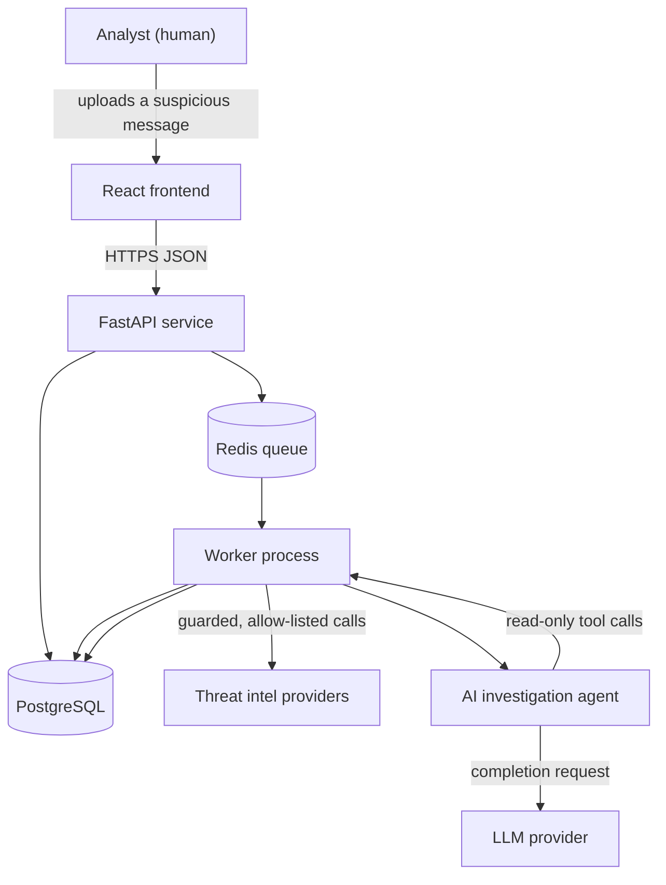

# PHISHGUARD Architecture

> **Status: design only.** Nothing described here is implemented. There is no
> backend, frontend, database schema, analysis module or agent code in this
> repository yet. This document describes the architecture the implementation
> will follow, so that design decisions are reviewable before code exists.

## Contents

1. [How to read this document](#1-how-to-read-this-document)
2. [System context](#2-system-context)
3. [Components and responsibilities](#3-components-and-responsibilities)
4. [Data flow](#4-data-flow)
5. [Planned data model](#5-planned-data-model)
6. [Explainable risk scoring](#6-explainable-risk-scoring)
7. [AI investigation agent](#7-ai-investigation-agent)
8. [Deployment topology](#8-deployment-topology)
9. [Failure handling](#9-failure-handling)
10. [Out of scope for the first release](#10-out-of-scope-for-the-first-release)
11. [Open questions](#11-open-questions)

---

## 1. How to read this document

A short glossary for readers who are new to this stack.

| Term | Plain meaning |
|---|---|
| API | The public boundary of the system: a defined set of requests a caller can make. |
| FastAPI | A Python web framework used to build that boundary. |
| ORM | A layer that lets code work with database rows as normal objects instead of raw SQL. |
| Migration | A versioned, repeatable script that changes the database schema. |
| Queue | A holding area for work that must not block a user's request. |
| Worker | A separate process that takes jobs from the queue and runs them. |
| SSRF | Server-Side Request Forgery: tricking a server into making a request the attacker chooses, often to reach internal systems. |
| Intel | Threat intelligence: external services that report reputation data for domains, URLs and file hashes. |
| Agent | An LLM that chooses which tools to call and in what order, within limits we set. |

Two rules shape every component below: untrusted input never executes, and
nothing outbound happens without an allow-list check.

## 2. System context



Trust boundaries, marked explicitly:

- **Browser to API.** Untrusted. Every field validated by a schema; uploads size
  capped.
- **Email content to parser.** Untrusted and hostile. Parsed as data only.
- **Worker to intel providers.** Outbound. Allow-listed hosts, guarded by an SSRF
  check, sized and timed out.
- **Agent to LLM provider.** Outbound. Email content is sent as data inside a
  prompt, never as instructions.

## 3. Components and responsibilities

| Component | Responsibility | Explicitly not responsible for |
|---|---|---|
| React frontend | Upload a message, show progress, render the report, score breakdown and agent trail | Analysis, scoring, any direct database access |
| FastAPI service | Authenticate the caller, validate input, store the raw message, enqueue work, serve results | Parsing logic, scoring logic, calling intel providers |
| Worker | Run the analysis pipeline: parse, analyse, enrich, score, invoke the agent | Accepting inbound traffic from users |
| Ingestion module | Decode the uploaded bytes into headers, body parts, link list and attachment metadata | Executing, opening, decompressing or rendering anything |
| Static analysis modules | Produce signals: authentication results, header forensics, URL structure, lookalike domains, attachment identifiers | Deciding the final verdict on their own |
| Intel adapters | Query one provider each, behind the shared SSRF guard and response limits, with caching | Trusting a provider's answer unconditionally |
| Scoring engine | Turn signals into a weighted score with a reason per signal | Using a signal it cannot explain |
| AI investigation agent | Plan an investigation, call a fixed set of read-only tools, synthesise a narrative grounded in collected evidence | Writing to the database, making network calls, deciding the score, taking any remediation action |
| Audit trail | Append-only record of pipeline steps, tool calls and agent decisions | Being editable after the fact |

## 4. Data flow

1. **Upload.** The analyst submits a message file. The API checks size against
   `PHISHGUARD_MAX_UPLOAD_BYTES`, checks the declared content type, assigns a
   content hash, and stores the raw bytes unmodified. Nothing is parsed at this
   point.
2. **Enqueue.** The API creates an analysis run and enqueues a job. The response
   returns an identifier the frontend can poll.
3. **Parse.** The worker decodes the message using Python's standard `email`
   package. It extracts header fields, the text and HTML bodies, the list of
   links, and attachment metadata: filename, declared type, size, SHA-256 hash.
   Attachments are never opened. Archives are not expanded in the first release.
4. **Analyse.** Static modules run over the parsed representation and emit
   signals. Each signal has an identifier, a severity, and a short
   human-readable explanation.
5. **Enrich.** For each domain, URL and file hash that survives a normalization
   and de-duplication pass, the worker consults the applicable intel adapters.
   `src/` responses are cached with a time to live, and every response is stored
   with its timestamp so a report can be reproduced.
6. **Score.** The scoring engine combines signals into a score with a
   per-signal contribution and reason.
7. **Investigate.** The agent receives the signals and enrichment as data,
   investigates within its tool budget, and writes a narrative. It cannot change
   the score.
8. **Report.** The run is marked complete. The frontend renders the score
   breakdown, signal list, enrichment evidence and agent narrative.

Every step writes an audit record: what ran, on what input identifier, when, and
with what outcome.

## 5. Planned data model

Entity sketch, subject to change during implementation:

| Entity | Purpose | Notes |
|---|---|---|
| `message` | The uploaded raw message | Stores content hash, size, received timestamp. Raw bytes stored unmodified. |
| `parsed_artifact` | Extracted headers, bodies, links, attachments | JSONB, one row per run so history is preserved |
| `analysis_run` | One execution of the pipeline | Status, timing, tool and software versions |
| `signal` | One observation with a reason | Links to the module that produced it |
| `score` | The computed risk score | Stores the per-signal contribution used at the time |
| `intel_lookup` | One provider query and its response | Stores provider, target, timestamp, cached response |
| `agent_step` | One agent decision or tool call | Append-only; the basis of the audit trail |
| `audit_event` | Cross-cutting record of pipeline actions | Append-only |

Sensitive content stays in `message` and `parsed_artifact`; the rest references
it by identifier, so logs can stay free of raw message content.

## 6. Explainable risk scoring

The score exists to support a human decision, not to replace it. The design rule
is: **no contribution without a reason.**

Shape of the intended output:

```json
{
  "score": 78,
  "band": "high",
  "contributions": [
    {
      "signal": "dmarc_fail",
      "weight": 30,
      "reason": "The receiving server recorded a DMARC failure for the sending domain."
    },
    {
      "signal": "reply_to_mismatch",
      "weight": 20,
      "reason": "Reply-To points to a different registered domain than the From address."
    },
    {
      "signal": "link_domain_lookalike",
      "weight": 18,
      "reason": "A link host resembles a well-known brand domain but is not it. Edit distance 1."
    },
    {
      "signal": "intel_hash_known_malicious",
      "weight": 10,
      "reason": "An attachment hash matches a provider's record of known malicious samples."
    }
  ],
  "missing_evidence": [
    "A provider was unavailable, so its signals were not evaluated."
  ]
}
```

Design rules:

- Weights are declared in one reviewable place, not scattered through modules.
- Signals that could not be evaluated are reported in `missing_evidence`, so an
  incomplete analysis never looks like a clean one.
- The score is a summary of evidence. It is never presented without its reasons.
- An unavailable provider degrades the analysis visibly rather than silently.

## 7. AI investigation agent

The agent adds narrative and follow-up questions. It does not add authority.

**Loop.** Plan, call one allowed tool, read the result, repeat within a step
budget, then synthesise. The budget is `PHISHGUARD_AGENT_MAX_STEPS`; exhausting it
ends the investigation with what has been gathered.

**Tool surface (read-only, no general network access):**

| Tool | Returns |
|---|---|
| `get_parsed_headers` | Header fields already extracted |
| `get_links` | Normalized links and their registered domains |
| `get_attachment_metadata` | Filenames, types, sizes, hashes |
| `get_signals` | Signals produced so far |
| `lookup_domain_reputation` | Cached or freshly guarded provider result |
| `lookup_hash_reputation` | Cached or freshly guarded provider result |
| `record_finding` | Appends a narrative finding to the audit trail |

There is no shell tool, no file-write tool, and no fetch-any-URL tool.

**Prompt-injection stance.** Email content, headers and provider responses are
rendered into the prompt inside clearly delimited data blocks. Any instruction
found inside that data is reported as a finding, not followed. The agent's
abilities are bounded by the tool list, so a successful injection still cannot
reach the network or the database.

**Auditability.** Each step records the tool name, the arguments, a result
digest, and the rationale text. A reviewer can reconstruct the investigation
without re-running it.

## 8. Deployment topology

Local development, once implementation reaches the container step:

| Service | Purpose | Notes |
|---|---|---|
| `frontend` | Serves the built React application | Non-root, no database access |
| `api` | FastAPI service | Non-root, read/write database, no egress except the queue |
| `worker` | Analysis pipeline and agent host | Non-root, egress only through the intel allow-list |
| `db` | PostgreSQL 16 | Not published on a public interface; credentials from environment |
| `cache` | Redis for queue and caches | Not published publicly |

Production topology is deliberately undecided. The first release target is a
reproducible local stack plus CI, and nothing more.

## 9. Failure handling

| Failure | Intended behaviour |
|---|---|
| Malformed message | Reject with a clear error; never attempt partial execution |
| Message too large | Reject at the API boundary before reading the body fully |
| Intel provider times out or errors | Record the failure, add it to `missing_evidence`, continue |
| Intel provider returns an unexpected payload | Treat as untrusted; store raw, parse defensively, never assume shape |
| Queue backlog | Widen the budget or refuse new jobs with a clear message; never silently drop |
| Agent step budget exhausted | Stop, keep partial findings, mark the narrative as incomplete |
| LLM provider unavailable | Complete the analysis without a narrative; the score still stands on signals |

## 10. Out of scope for the first release

Named explicitly so they are not assumed:

- Sending, quarantining or deleting mail. PHISHGUARD reads and reports only.
- Mailbox or mail-server integration: input is an uploaded file.
- Visiting URLs, sandboxing attachments, or detonating payloads.
- Archive expansion and recursive attachment analysis.
- Multi-tenant identity, roles and per-team isolation.
- Automatic remediation or blocking.
- Model training or fine-tuning. The agent uses a provider model as-is.
- Production hosting, scaling or high availability.

## 11. Open questions

1. Authentication mechanism for the API and dashboard (single-user versus
   multi-user) and whether it is needed for the first release.
2. Evidence retention period, and whether raw messages should be deletable on
   request.
3. Which intel providers are in the first allow-list, and their free-tier
   quotas.
4. Which LLM provider and model, and whether local inference is required.
5. Whether scoring weights live in configuration or in code.
6. Whether the agent runs inline in the worker or in its own process, given that
   the tool surface is read-only and could be mediated by an internal interface.
